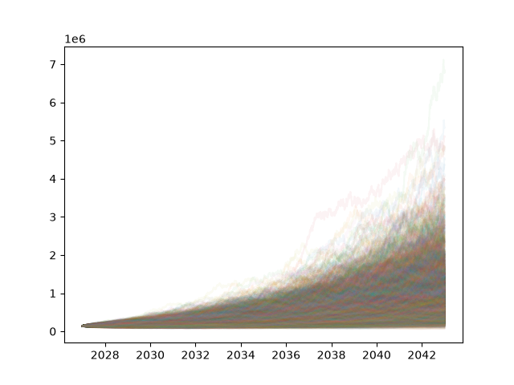
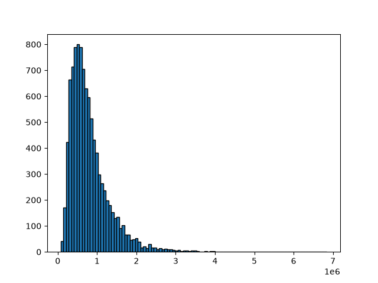

# Simple Quantitative Algorithm for Wharton Global Investment Competition
[wharton logo]: https://github.com/nalm1223/wharton-quant-algo-2026/blob/main/images/wharton%20logo.avif
[global competition logo]: https://github.com/nalm1223/wharton-quant-algo-2026/blob/main/images/global%20competition%20logo.avif

![alt text][wharton logo]

## Table Of Contents
- [Initial Algorithm Objectives](#initial-algorithm-objectives)
- [Rationale](#rationale)
  - [Mean Variance Portfolio Optimization](#mean-variance-portfolio-optimization)
  - [Monte Carlo](#monte-carlo)
- [Assumptions](#assumptions)
- [Results](#results)
  - [Competition Outcomes](#competition-outcomes)
- [Sources](#sources)

## Initial Algorithm Objectives
The case study (Laura Gao) objectives include:
- The creation of a portfolio with an initial investment of $300,000
- An additional investment of $150,000 one year after the brokerage account is opened
- A $50,000 annual drawdown six years after the account opens

Stock selection was dictated by fundamental research done by our team, so the algorithm would need to
- Find the amount of money to put into each chosen stock to ensure a balance of risk and return for initial investments
- Create a distribution for possible returns for the portfolio
- Make the best allocations/de-allocations that fit Laura's goals

## Rationale
### Mean Variance Portfolio Optimization
What we found to be best for establishing this first criteria is a negative sharpe ratio optimization. This involved an initial investment into each stock relative to pseudo-risk-parity (stocks of similar fundamental statistics were bought in similar amounts, with higher risk investments having a lower proportion to lower risk). These investments would then be converted to an array of allocation weights, the total allocation of a single stock divided by the total allocation towards the entire portfolio.

Then, each allocation weight is adjusted such that its sharpe ratio is maximized.
> In practice, this involves the *minimization* of a *negative* sharpe ratio, that way an optimization algorithm with less overhead is able to be used.

This negative sharpe ratio is calculated by the following procedures:

### $R_p = 252(\sum_{i=1}^{n} w_i\bar{R_i})$

The annualized return of the portfolio is calculated as the sum of the quantity of each allocation weight $w_i$ times the mean of its daily returns $\bar{R_i}$, all multiplied by 252 for the number of yearly trade days.

### $R_{rfr} = 0.042$

The risk-free-return $R_{rfr}$ is set at 4.2%, the approximated return of a US-style bond.

### $\sigma_p = \sqrt{w^T \cdot (\Sigma \cdot w)}$

The standard deviation of the portfolio $\sigma_p$ is the square root of the dot product between the transposition of weights (vertical vector $w^T$) and the dot product between the covariance matrix $\Sigma$ and each weight (horizontal vector $w$).

### $-{Sharpe Ratio} = \frac{R_p - R_{rfr}}{-\sigma_p}$

Our model function for our optimization then returns the negative sharpe ratio, our metric for optimized mean-variance.

Using a COBYLA (Constrained Optimization BY Linear Approximation) minimization algorithm, the weights of each allocation can be fit such that the negative sharpe ratio of the portfolio is as low as possible, given the list of tickers (stocks) themselves.

> This methodology is almost identical to that showcased in [this article](https://medium.com/@andrejin.nagano/portfolio-optimization-explained-python-code-d15cd017ff31), so much of the credit for *portfolio_managing.py* goes to Andre Nagano.

### Monte Carlo
The second criteria is best approached with a Monte Carlo algorithm. Using the same $R_p$ and $\sigma_p$ values of the optimized portfolio, a Monte Carlo simulation can be modeled by a normal distribution with a mean of $R_p$ and a variance of $(\sigma_p)^2$.

Provided a value of the number of simulations and the amount of years to project, a Monte Carlo will simulate a stochastic walk of the portfolio's value over time, with respect to this distribution, for each simulation. This data will create a new distribution curve that can be showcased with a frequency graph, where each bar's height is the number of times the projected value of the stock falls within a given range.

## Assumptions
- By bounding the possible allocation weight of a stock such that $0.05 \leq w_i \leq 0.4$, the optimization algorithm won't over-allocate to tickers of certain sectors (eg. utilities) and promote diversification.

- Projected return outcomes will follow a normal distribution $\mathcal{N}(\mu,\sigma^2)$, where its mean ($\mu$) is equal to the portfolio's annualized return, and its variance ($\sigma^2$) is the standard deviation of the ticker or portfolio squared

  - This eliminates some of the tail-events of the market (scenarios of many standard deviations from the norm, market bubbles or crashes), which is viable due to the general low-volatility assets chosen by our team (ETFs, utilities, energy, etc.)

- The standard deviation and annualized return for each ticker remains constant over the course of the account's position in the market, as over 10 years of historical data is utilized to find $R_p$ and $\sigma_p$ (2904 total historical trade days accounted for with current stocks)

- The total number of bars of the frequency distribution remains constant and was chosen to be 100 for any Monte Carlo, which has shown to be sufficient at illustrating the median simulation price and approximate deviation from this median.

## Results
### Competition Outcomes
Due to the unfortunate circumstances, we were not able to continue development of the algorithm within the competition due to a disqualification (a deliverable was not turned in at the deadline). Despite this, many of the initial objectives of our algorithm were able to be completed.

Firstly, sharpe portfolio optimization was able to be implemented, and from that initial balances of assets could take place. Given our initial budget and trades made in StockTrak, our algorithm was able to find the allocation weighting strategy best fit to both a high sharpe ratio and our boundary conditions discussed in our Rationale.
```
Initial Weights: 
[0.10541159 0.10461853 0.10554775 0.22596566 0.07855724 0.10468204
 0.1180922  0.157125  ]
Initial Return: 0.10941451809666095, Initial STD: 0.14239456031122955
Initial Sharpe Ratio: -0.5573860696436768

Optimized Weights: 
[0.27122521 0.05012215 0.09220157 0.05010336 0.38629033 0.04987927
 0.05001688 0.05016121]
Optimized Return: 0.16123408497635527, Optimized STD: 0.170838810618703
Optimized Sharpe Ratio: -0.7901960358718285
```
From these optimized allocation weights, allocations to each ticker can be made, rounding each weight to the nearest whole share of each stock:
| Symbol | Number of Shares |
| ----   |       :---:      |
| GLD    | 216              |
| INTF   | 367              |
| PG     | 165              |
| SCHD   | 423              |
| SMH    | 258              |
| VNQ    | 155              |
| VPU    | 80               |
| VTV    | 67               |

By increasing our annualized return by ~5% and our standard deviation by ~3%, our return was able to optimized without compromising our risk, improving our portfolio overall.

Additionally, the portfolio's future return distribution was able to be modeled over the course of 16 years with our initial investment of $300,000, without any additional allocations or de-allocations:

<p align="center">
  
  
</p>

> The left figure showcases the portfolio's open position total with respect to time for each simulation, and the right figure indicates the frequency distribution of each price bar (100 total)

## Sources
1. [Python For Finance - GitHub](https://github.com/teobeeguan/Python-For-Finance)
2. [Portfolio Optimization Explained + Python Code - Medium](https://medium.com/@andrejin.nagano/portfolio-optimization-explained-python-code-d15cd017ff31)
3. [Monte Carlo Simulation for your portfolio: a practical guide - Wallible](https://www.wallible.com/en/blog/monte-carlo-simulation-portfolio-guide/)
4. [Stock Analysis with Monte Carlo Simulation - GitHub](https://github.com/theanh97/Monte-Carlo-Simulation-for-Stock-Market)
5. [Daniel Boctor YoutTube - GitHub](https://github.com/daniel-boctor/Daniel-Boctor-Youtube)
6. [Portfolio Risk and Return - Kellogg](https://www.kellogg.northwestern.edu/faculty/hagerty/ftp/Emp_Investments/Lectures/PortfolioTheory_2_Jan_1_20081.pdf)
